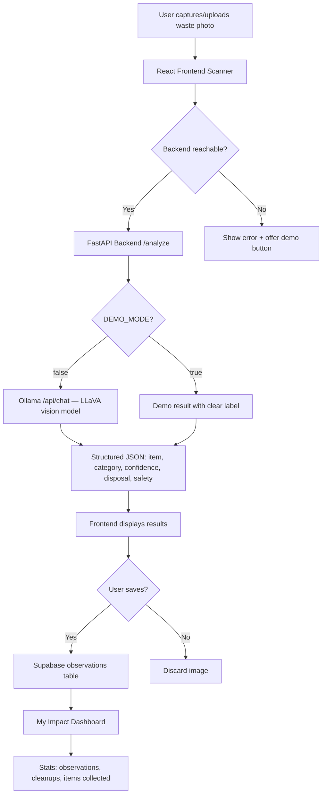

# EcoSnap — From Waste to Action

**Small Actions. A Cleaner Planet.**

EcoSnap is an AI-powered environmental assistant that helps people identify waste, learn how to dispose of it responsibly, and track their environmental cleanup activities. Built for the **Hacktoberfest 2026 Open-Source AI Challenge — Week 1**, whose theme is **"Touch Grass."**

---

## Table of Contents

1. [The Problem](#1-the-environmental-problem)
2. [Features](#2-project-features)
3. [Architecture](#3-architecture-and-data-flow)
4. [AI Model](#4-ai-model-and-license)
5. [Local AI Inference](#5-how-local-ai-inference-works)
6. [Installation (Windows)](#6-installation-instructions-for-windows)
7. [Ollama & Model Setup](#7-how-to-install-and-run-ollama-and-the-selected-model)
8. [Running the App](#8-how-to-start-the-backend-and-frontend)
9. [Testing](#9-how-to-test-the-api-and-application)
10. [Limitations](#10-known-limitations-and-future-improvements)
11. [Open Innovation](#11-why-open-innovation-matters-for-ecosnap)
12. [Touch Grass Theme](#12-how-the-project-supports-the-touch-grass-theme)

---

## 1. The Environmental Problem

Every day, millions of tons of waste are mismanaged — thrown into the wrong bin, dumped in nature, or left where it shouldn't be. A major barrier to correct disposal is simple: **people don't always know what something is made of or how to dispose of it safely.**

EcoSnap addresses this by:
- Letting you photograph waste and get an instant AI-powered identification
- Providing clear, practical disposal guidance
- Flagging hazardous or dangerous items that need professional handling
- Tracking your own cleanup activities so you can see your real impact

The app is designed to be used outdoors — you spot waste, scan it, learn what to do, act, and then get back to enjoying nature.

---

## 2. Project Features

### Waste Scanner
- Upload an image or take a photo on mobile devices
- AI identifies the waste category, likely item name, and confidence level
- Supports: Plastic, Paper & cardboard, Glass, Metal, Organic waste, Electronic waste, Mixed/unknown
- When the AI backend is unavailable, a clearly-labeled "Try demo result" button is available — demo results are never shown as if they were real AI analysis

### Responsible Disposal Guidance
- **What is it?** — the likely item and material
- **What should I do?** — practical disposal steps
- **Stay safe** — relevant precautions and warnings
- Hazardous/medical/chemical waste is flagged for professional collection

### My Eco Activity Dashboard
- View saved waste observations
- Record cleanup activities (items actually collected, separately from scanned items)
- See category breakdown of identified waste
- Delete records
- Data persists in a Supabase database (works even without the Python backend running)

### Eco Tips
- A collection of practical environmental tips
- Safety reminders for outdoor cleanup activities

### Privacy
- Image analysis runs locally through Ollama when configured
- No photos are uploaded to third-party AI providers
- No permanent image retention unless you explicitly save an observation

---

## 3. Architecture and Data Flow



**Tech Stack:**
- **Frontend:** React + TypeScript + Vite + Tailwind CSS + Lucide React
- **Backend (AI only):** Python + FastAPI — serves `/health` and `/analyze`
- **AI:** LLaVA (open-weight vision-language model) via Ollama
- **Data persistence:** Supabase (PostgreSQL) for observations and cleanups — works without the Python backend

**Data flow summary:**
- Image analysis: Frontend → FastAPI `/analyze` → Ollama `/api/chat` with LLaVA → structured JSON
- Observations/cleanups: Frontend → Supabase (direct, no backend needed)
- Health check: Frontend → FastAPI `/health` → checks Ollama reachability and model availability

---

## 4. AI Model and License

### Selected Model: LLaVA (Large Language and Vision Assistant)

**Why LLaVA?**
- Open-weight **vision-language** model — it can actually understand and analyse images, unlike text-only models
- Available through Ollama for easy local inference
- Can describe images, answer questions about visual content, and produce structured JSON output
- No paid API key required

**Model name in Ollama:** `llava:7b` (recommended) or `llava:13b` for machines with more RAM/GPU.

**Exact install command:**
```powershell
ollama pull llava:7b
```

**License note:** LLaVA provides **open weights**, not a fully open-source license in the OSI definition sense. The model weights are available for research and commercial use under specific terms, but some training data and components may have separate licensing. We are transparent about this distinction and do not claim the model is fully open-source when it provides open weights.

**Limitations:**
- May misidentify unusual or ambiguous waste items
- Confidence is expressed descriptively ("Likely," "Uncertain," "Needs manual verification") — no fabricated numerical scores
- CPU-only inference works but is slower (10–60+ seconds per image)
- GPU inference is recommended for reasonable speed

---

## 5. How Local AI Inference Works

1. **Ollama** runs as a local server on your machine (default: `http://localhost:11434`)
2. The FastAPI backend sends the uploaded image (base64-encoded) to Ollama's `/api/chat` endpoint with the LLaVA model and `"format": "json"` to force structured JSON output
3. LLaVA processes the image and returns a JSON response with item name, category, confidence, disposal guidance, and safety warnings
4. The backend validates and normalizes the response before returning it to the frontend
5. The image is never sent to any external service — it stays on your machine

**Initial model download** requires internet access (the model is ~4.7 GB for `llava:7b`). Once downloaded, inference can run fully offline.

**Demo mode:** The backend can run with `DEMO_MODE=true` in `backend/.env` for testing the frontend without Ollama. Demo results are clearly labelled and no real AI analysis is performed. Demo mode is **never** used as a silent fallback — if Ollama is unreachable and demo mode is off, the `/analyze` endpoint returns an HTTP 503 error with a clear message.

**Frontend behavior when backend is offline:**
- The scanner shows a "Backend not running" status banner
- The "Analyse with AI" button is disabled
- A separate "Try demo result" button is available and clearly labeled as demo
- Demo results show a prominent warning banner explaining they are not real AI analysis

---

## 6. Installation Instructions for Windows

### Prerequisites
- **Node.js 18+** — Download from [nodejs.org](https://nodejs.org)
- **Python 3.10+** — Download from [python.org](https://python.org) (check "Add to PATH" during installation)
- **Ollama** — Download from [ollama.com](https://ollama.com)

### Step 1: Clone the repository
```powershell
git clone https://github.com/your-username/ecosnap.git
cd ecosnap
```

### Step 2: Frontend setup
```powershell
npm install
```

### Step 3: Backend setup (for AI analysis only)
```powershell
python -m venv venv
.\venv\Scripts\Activate.ps1
pip install -r backend\requirements.txt
```

> If PowerShell blocks the activation script, run this once:
> ```powershell
> Set-ExecutionPolicy -ExecutionPolicy RemoteSigned -Scope CurrentUser
> ```

### Step 4: Configure environment files
```powershell
Copy-Item backend\.env.example backend\.env
Copy-Item frontend\.env.example frontend\.env
```

Edit `backend\.env` to set the Ollama URL, model name, or demo mode if needed. The defaults (`OLLAMA_URL=http://localhost:11434`, `OLLAMA_MODEL=llava:7b`, `DEMO_MODE=false`) work for a standard local Ollama install.

The frontend reads `VITE_API_URL` from `frontend\.env` (default: `http://localhost:8000`). Set this to your backend's URL.

---

## 7. How to Install and Run Ollama and the Selected Model

### Install Ollama
1. Download Ollama from [ollama.com](https://ollama.com)
2. Run the installer
3. Open a **PowerShell** terminal and verify installation:
   ```powershell
   ollama --version
   ```

### Pull the LLaVA vision model
```powershell
ollama pull llava:7b
```

This downloads the model (~4.7 GB). The download requires internet access. Once complete, inference runs locally and offline.

### Start the Ollama server
Ollama typically starts automatically after installation. If it's not running, start it in a separate terminal:
```powershell
ollama serve
```

Verify the model is available:
```powershell
ollama list
```

You should see `llava:7b` in the list. If you don't, the pull hasn't finished or failed — re-run `ollama pull llava:7b`.

> **Important:** The model name `llava:7b` must match the `OLLAMA_MODEL` setting in `backend\.env`. If you pull a different model (e.g. `llava:13b`), update the env file accordingly.

---

## 8. How to Start the Backend and Frontend

You need **three terminal windows** (or two if Ollama is already running):

### Terminal 1 — Ollama (skip if already running)
```powershell
ollama serve
```
Leave this running. It serves the AI model on port 11434.

### Terminal 2 — FastAPI Backend (from the project root)
```powershell
.\venv\Scripts\Activate.ps1
python -m uvicorn backend.main:app --reload --host 0.0.0.0 --port 8000
```

The API runs on **port 8000**. Interactive docs at `http://localhost:8000/docs`.

Verify it's working:
```powershell
curl http://localhost:8000/health
```

You should see `"backend": "online"` and `"ai_service": "online"` if Ollama and the model are ready.

### Terminal 3 — Frontend (from the project root)
```powershell
npm run dev
```

The frontend runs on **port 5173**. Open `http://localhost:5173` in your browser.

> If you changed the backend port, update `VITE_API_URL` in `frontend\.env` to match.

---

## 9. How to Test the API and Application

### Backend tests (run from the project root)
```powershell
cd backend
..\venv\Scripts\Activate.ps1
$env:DEMO_MODE = "true"
pytest tests/ -v
```

Tests run in demo mode (no Ollama required) and cover:
- Health endpoint status and AI service reporting
- Image file validation (unsupported types, empty files)
- Demo mode analysis returns valid structured results
- Saving and retrieving observations
- Deleting observations (including 404 for nonexistent IDs)
- Activity statistics
- Cleanup recording and validation

### Manual API testing

**Check health (backend + AI status separately):**
```powershell
curl http://localhost:8000/health
```

**Test image analysis with a real photo:**
```powershell
curl -X POST http://localhost:8000/analyze -F "file=@C:\path\to\your\waste-photo.jpg"
```

Or use the interactive docs at `http://localhost:8000/docs`.

### Testing a real photo end-to-end

1. Make sure Ollama is running (`ollama serve`) and the model is pulled (`ollama list` shows `llava:7b`)
2. Start the backend (Terminal 2) and frontend (Terminal 3)
3. Open `http://localhost:5173` in your browser
4. Go to **Scan Waste**
5. You should see a green "AI backend is online" banner
6. Upload or take a photo of a real waste item (e.g. a plastic bottle, cardboard box, aluminum can)
7. Click **Analyse with AI**
8. Wait for the result (may take 10–60 seconds on CPU, faster with GPU)
9. Verify the result shows a real item name, category, disposal guidance, and safety info
10. Click **Save observation** and check it appears in **My Impact**

### Testing the error state

1. Stop the FastAPI backend (Ctrl+C in Terminal 2)
2. Refresh the Scan Waste page
3. You should see an orange "Backend not running" banner
4. The "Analyse with AI" button should be disabled
5. The "Try demo result" button should still work and show a clearly-labeled demo result

---

## 10. Known Limitations and Future Improvements

### Limitations
- **AI accuracy:** LLaVA may misidentify waste, especially unusual items. Always use human judgment.
- **Local hardware:** Running LLaVA requires sufficient RAM (8 GB minimum, 16 GB recommended). CPU-only inference is slow.
- **General disposal guidance:** Recycling rules vary by location. Guidance is general — always check local rules.
- **No image storage:** Images are not permanently stored. Only metadata is saved with observations.
- **Single user:** No authentication — the app tracks activity for one local user.
- **Not tested with live Ollama in this environment:** The backend code and API contract are complete, but end-to-end testing with a running Ollama + LLaVA instance requires manual setup on your machine.

### Future improvements
- Location-aware disposal rules (integrate with local council APIs)
- Multi-language support
- Community cleanup event finder
- Offline mode for the frontend (PWA)
- Support for additional vision models
- Photo storage for saved observations
- Barcode/QR code scanning for packaged products

---

## 11. Why Open Innovation Matters for EcoSnap

Environmental challenges are global, but they require local action. Open innovation — making AI models, code, and data accessible — means that anyone, anywhere, can use and improve tools like EcoSnap without paying for proprietary APIs or sending their data to third-party servers.

By using an open-weight vision model that runs locally, EcoSnap demonstrates that:
- Useful AI tools can be built without paid APIs
- Privacy-preserving AI is possible for environmental applications
- Community-driven development can address real-world problems
- Technology can encourage people to engage with nature, not retreat from it

---

## 12. How the Project Supports the "Touch Grass" Theme

The Hacktoberfest 2026 "Touch Grass" theme encourages participants to go outdoors and engage with the natural world. EcoSnap embodies this:

1. **Go outside:** The scanner is designed for mobile use — take your phone outside, photograph waste you find
2. **Observe:** The AI helps you understand what waste is made of and why it matters
3. **Act:** Get practical disposal guidance and record cleanup activities
4. **Return to nature:** The app is intentionally simple — scan, learn, act, and put your phone away

The app doesn't gamify screen time or encourage endless scrolling. It's a tool you pick up, use quickly, and put down so you can get back to enjoying the outdoors.

---

## Project Structure

```
ecosnap/
├── src/                        # React frontend source
│   ├── components/             # Reusable UI components (Navbar, Footer, ResultCard, ErrorBanner)
│   ├── pages/                  # Page components (Home, Scanner, Impact, Tips, About)
│   ├── api.ts                  # API client — Supabase for data, FastAPI for AI analysis
│   ├── demo.ts                 # Demo result generator (explicitly labeled, never silent fallback)
│   ├── data.ts                 # Static data (eco tips, category metadata)
│   ├── types.ts                # TypeScript type definitions
│   └── App.tsx                 # Main app component with routing
├── backend/                    # FastAPI backend (AI analysis only)
│   ├── main.py                 # FastAPI app: /health, /analyze, /observations, /cleanup, /stats
│   ├── models.py               # Pydantic request/response schemas
│   ├── database.py             # SQLite data layer (used by backend tests)
│   ├── ai_service.py           # Ollama /api/chat integration with LLaVA vision model
│   ├── requirements.txt        # Python dependencies
│   ├── .env.example            # Backend config: OLLAMA_URL, OLLAMA_MODEL, DEMO_MODE
│   └── tests/                  # Backend tests (run in demo mode, no Ollama needed)
├── frontend/
│   └── .env.example            # Frontend config: VITE_API_URL
├── supabase/                   # Supabase migrations (observations + cleanups tables)
├── README.md
└── .gitignore
```

---

## Files Changed in This Update

| File | Change |
|------|--------|
| `backend/ai_service.py` | Switched to `/api/chat` endpoint, added `"format": "json"`, improved error messages, removed silent demo fallback |
| `backend/.env.example` | Clearer documentation of model requirements and demo mode behavior |
| `src/pages/ScannerPage.tsx` | Separate "Analyse with AI" and "Try demo result" buttons; real errors shown instead of hidden demo fallback; four-state status banner |
| `src/pages/HomePage.tsx` | Updated AI status text to describe all four states (online/demo/AI-offline/backend-offline) |
| `README.md` | Corrected architecture diagram, added exact PowerShell commands, documented how to test a real photo |

---

## Remaining Manual Setup Steps

1. **Install Ollama** from [ollama.com](https://ollama.com)
2. **Pull the vision model:** `ollama pull llava:7b`
3. **Install Python dependencies:** `pip install -r backend\requirements.txt`
4. **Copy env files:** `Copy-Item backend\.env.example backend\.env` and `Copy-Item frontend\.env.example frontend\.env`
5. **Start Ollama:** `ollama serve`
6. **Start the backend from the project root:** `.\venv\Scripts\Activate.ps1` followed by `python -m uvicorn backend.main:app --reload --host 0.0.0.0 --port 8000`
7. **Start the frontend:** `npm run dev`
8. **Verify health:** Open `http://localhost:8000/health` — should show `"ai_service": "online"`
9. **Test with a real photo:** Upload a waste photo on the Scan page and verify real AI results

> **Not yet tested with a live Ollama instance.** The backend code, API contract, and error handling are complete, but end-to-end verification with a running Ollama + LLaVA model requires manual setup on your machine following the steps above.

---

Built for Hacktoberfest 2026 Open-Source AI Challenge — Week 1: "Touch Grass."
